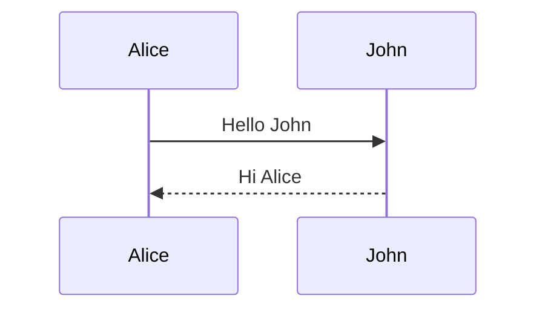

# Writing slides

A deck is a normal note. YAAS uses the same format as Obsidian's built-in Slides, so a deck works in both.

## Slides

- A line with only `---` starts a new slide.
- The properties block at the top of the note is not a slide.
- A `---` inside a code block does not split slides.

## Speaker notes

Put notes in a comment: `%% Remember to say hello %%`. They are hidden on the slide; press **N** while presenting to see them.

## Slide settings

A comment that starts with `slide` changes **that slide only**:

```markdown
%% slide bg=#6B2BD9 text=#FFF7E8 accent=#FFE45C %%
```

| Key | What it does | Values |
| --- | --- | --- |
| `bg` | Background colour | a colour |
| `text` | Text colour | a colour |
| `accent` (or `highlight`) | Highlight colour: bold text, bullets, links, slide number | a colour |
| `align` | Where the content sits | `left` puts it at the top; middle by default |
| `image` | A picture behind the whole slide | `[[photo.jpg]]`, `photo.jpg` or an `https://` link |
| `dim` | Darkens that picture so text stays readable | `0` (none) to `1` (black) |
| `layout` | Puts the slide's first image in one half | `image-left` or `image-right` |
| `fit` | How images fill their space | `cover` (fill and crop, default) or `contain` (whole picture) |

Colours can be hex (`#FFE45C`), `rgb(…)`, `hsl(…)` or a name (`white`).

You don't have to type these: the [slides panel](slides-panel.md) writes them for you.

## Colours for the whole deck

Add note properties:

```yaml
---
slide-bg: "#A9DCFF"
slide-text: "#0A2A55"
slide-accent: "#0049B8"
---
```

A slide's own colours win over the note's, and the note's win over the [settings](settings.md).

### The three colours

- **Background**: the whole slide.
- **Text**: headings, normal text, tables, diagram lines.
- **Highlight**: what should stand out: **bold text**, bullets and numbers, links, the slide number, the progress line. Pick one that is clearly different from the text colour.

## Images

- `![[photo.jpg]]` in a slide shows the picture in the text (up to 640 px tall).
- With `layout=image-right`, the first picture fills the right half and the text goes left.
- With `image=[[photo.jpg]]`, the picture fills the whole slide behind the text. Add `dim=0.4` and a light `text` colour to keep text readable.

## Code

Code blocks sit on a dark card and size themselves:

- Short code grows to fill the slide (up to 56 px).
- Long code shrinks, but never below 20 px, so it stays readable.
- A very long line wraps onto the next line.
- If code still does not fit, the bottom fades out with a badge such as **↓ 12 more lines**. Split it over two slides.

## Diagrams

A ` ```mermaid ` block fills the space under the heading, centred, in the slide's colours.

````markdown

````
